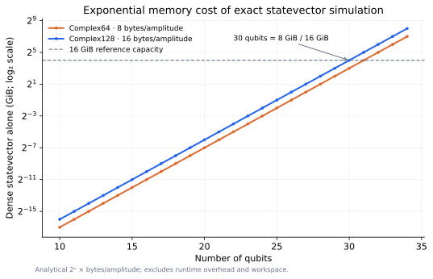

# gpu-quantum-sim

**GPU-accelerated quantum simulation & quantum chemistry, reproducibly.** This portfolio project uses [NVIDIA CUDA-Q](https://nvidia.github.io/cuda-quantum/) to compare the cost of simulating GHZ quantum circuits on a conventional CPU versus an NVIDIA GPU, then solves the four-qubit H₂ molecular ground-state problem using a first-order *unitary coupled-cluster singles and doubles* (UCCSD) variational circuit. PySCF's exact full-configuration-interaction (FCI) method provides an independent reference. Every benchmark is memory-guarded, every molecular energy includes nuclear repulsion, and measured numbers are generated from CSV outputs rather than hand-entered claims.

<!-- AUTO_RESULTS_START -->
### Measured results (generated directly from CSVs)

- **Largest completed statevector:** not measured yet (no GHZ CSV available).
- **GPU speedup:** not measurable yet (no matched CPU/GPU measurements).
- **H₂ VQE error:** not measured yet (no potential-energy CSV available).

**Résumé bullet (only when supported by measured results):**

> Not generated: requires measured CUDA-Q CPU/GPU rows *and* H₂ VQE rows.

<!-- AUTO_RESULTS_END -->

> **Status:** The repository includes executable experimental code and validation tests. The starter project does **not** include fabricated benchmark values, plots, or a claimed chemical-accuracy pass. Run the commands below on Linux/WSL2 or Colab T4 to populate the evidence.

## What scales as the problem gets harder?



*Analytical memory allocation estimate (computed, not a measured CUDA-Q benchmark).*

## The experiments

| Experiment | What it establishes | Output |
|---|---|---|
| GHZ correctness | Only `000…0` and `111…1` are observed, each at ~50% | pytest |
| GHZ CPU vs GPU | 1 warm-up and 5 timed runs per available `(target, n)`; median, sample SD, and all individual timings | [`ghz_benchmark.csv`](results/ghz_benchmark.csv), [`ghz_timings.csv`](results/ghz_timings.csv) |
| H₂/STO-3G | 4-qubit Jordan–Wigner Hamiltonian; **15** Pauli terms including identity | pytest, logs |
| UCCSD VQE | 3 excitation parameters, HF preparation, SciPy L-BFGS-B and `cudaq.observe` | [`vqe_convergence.csv`](results/vqe_convergence.csv) |
| H₂ bond scan | 0.30–2.50 Å inclusive in 0.05 Å steps (45 geometries), warm starts | [`h2_pes.csv`](results/h2_pes.csv) |
| Independent references | PySCF Hartree–Fock, FCI and the STO-3G hydrogen-atom asymptote | same CSV + metadata |

### Plots (created from executed experiments)


*The linked figures are intentionally absent until the corresponding experiment has run; an empty GPU speedup figure explicitly says that no matched measurements are available.*

## Why this is hard

An arbitrary `n`-qubit pure state has `2^n` complex amplitudes. **Memory doubles with each added qubit**: at 30 qubits, the dense state alone needs **8 GiB in complex64** or **16 GiB in complex128**—before work buffers and runtime overhead. Dense statevector gates generally touch O(2^n) amplitudes, even when the gate acts on only one or two logical qubits. This makes GPU memory bandwidth and available VRAM decisive.

The GPU simulation uses CUDA-Q's **`nvidia` / cuStateVec**, whose default here is FP32. The CPU uses **`qpp-cpu`** (Q++ / FP64). Consequently the performance numbers compare *these practical backend configurations*, not identical precisions, and include **kernel launch, simulation and sampling**. A GHZ circuit is also highly structured; the result must not be generalized to arbitrary random or chemistry circuits. CUDA-Q may optimize some sampling workloads, so these results are a meaningful workload-specific comparison, not a universal gates-per-second metric.

## How VQE works

1. **Define H₂ in STO-3G.** PySCF computes spatial-molecular-orbital integrals, Hartree–Fock energy and independent FCI energy. Nuclear repulsion is included in total energies.
2. **Map fermions to qubits.** OpenFermion applies the Jordan–Wigner transformation to obtain a four-qubit Hamiltonian, with 15 Pauli strings (counting `IIII`). The resulting terms are converted into `cudaq.SpinOperator`.
3. **Prepare the HF state and UCCSD excitations.** Two occupied spin-orbitals are initialized with X gates. The **first-order factorized UCCSD ansatz** applies the exponentials of two spin-preserving single excitations and one double excitation. It does **not** use a hardware-efficient rotation ansatz disguised as UCCSD; the fermionic excitation generators are mapped independently by OpenFermion into `exp_pauli` rotations. Factorization is a Trotter approximation to the single combined UCCSD exponential; for this four-qubit example it is a small, expressive circuit.
4. **Optimize the circuit.** L-BFGS-B changes three angles to minimize the noiseless expectation `cudaq.observe(ansatz, H, …).expectation()`. The optimizer's **iteration history** is saved; 0.735 Å is run separately for its convergence plot. Each scanned geometry warm-starts from the preceding optimum.
5. **Check against exact solutions.** A PySCF FCI computation gives the exact minimum **within STO-3G**. The plotted absolute difference is in **milli-Hartree (mHa)**; the common chemical-accuracy target is **1.6 mHa**. An optimizer whose error remains larger causes an explicit run failure after writing diagnostic data.

Expected order of magnitude, **not a reported measurement:** H₂/STO-3G near `R = 0.735 Å` has an energy around `−1.1373 Ha`. The full sweep's minimum typically falls at a neighboring discrete grid point (`0.75 Å`), not at exactly `0.735 Å`.

The dissociation reference is `2 × E(H atom)` recomputed in **the same STO-3G basis**. This is **not −1 Hartree** because a minimal basis does not reproduce the exact free hydrogen energy.

## Install and reproduce

**Requirements:** Linux x86-64 or Windows **WSL2**, Python **3.11+** (CUDA-Q 0.16 does *not* support Python 3.10), working `pip`; optional NVIDIA GPU and compatible driver for the GPU target. macOS Apple Silicon can run CPU-only. On Windows, use WSL2 rather than native Windows.

```bash
# From the unpacked project directory:
python3.11 -m venv .venv
source .venv/bin/activate
python -m pip install --upgrade pip
python -m pip install -r requirements.txt
python -m src.check_api             # inspect the ACTUAL installed CUDA-Q API
python -m pytest -q                # actual quantum + chemistry tests
python -m src.ghz_benchmark --max-qubits 30
python -m src.h2_vqe               # defaults to CPU FP64 for validation
python -m src.build_readme         # fill README stats from real CSV rows
```

If you want to use NVIDIA GPU FP64 also for chemistry (not needed for the four-qubit problem), use `python -m src.h2_vqe --target gpu`. This uses CUDA-Q `nvidia` with `option="fp64"` and falls back to CPU with a message if the GPU is unavailable.

For the one-command path:

```bash
make all          # install, inspect API, test, run GHZ and H2, update README
make quick        # reduced CPU-friendly smoke runs (typically <2 min on a decent CPU)
```

**Colab T4:** open [`notebooks/colab_quickstart.ipynb`](notebooks/colab_quickstart.ipynb) in Google Colab, select **Runtime → Change runtime type → T4 GPU**, upload the repository ZIP, and run the notebook. It installs the **CUDA 12** wheel using `requirements-colab.txt` instead of the generic `cudaq` meta-package to accommodate older GPU drivers. Colab's CPU RAM may make the *CPU* run skip the largest qubit counts; GPU may still reach them, but **speedups require a pair of measurements at the same n**. CUDA-Q's `nvidia-smi` query and free-memory safety fraction prevent expected OOMs, though allocation can still fail from fragmentation/other applications.

**Quick mode is not the full validation.** It uses GHZ `n=8,10,12` and just three H₂ geometries (`0.700`, `0.735`, `0.800` Å). Do not quote a quick-run maximum error as the full 45-point sweep error.

## Files and verification

```text
gpu-quantum-sim/
├── src/
│   ├── check_api.py            # runtime version, target and kernel API inspection
│   ├── system_info.py          # RAM/VRAM detection and environment metadata
│   ├── ghz_benchmark.py        # real GHZ kernel, correctness, timing, plots
│   ├── h2_vqe.py               # PySCF/FCI/JW/UCCSD/VQE pipeline + plots
│   ├── build_readme.py         # measured-numbers-only README and CV bullet
│   └── plot_style.py           # consistent publication plots
├── tests/                     # real pytest validations and pure unit tests
├── notebooks/colab_quickstart.ipynb
├── results/                   # generated CSV, PNG, metadata.json
├── requirements.txt
├── requirements-colab.txt
├── requirements-common.txt
├── Makefile
└── README.md
```

All runs save environment metadata to `results/metadata.json` (platform, Python, CPU, NVIDIA device and driver, library versions, precision, seed, scan mode, optimizer). The readme generator reads the actual CSVs; **it will never fill a missing GPU speedup with a guessed number.** A test marked *skipped* because CUDA-Q is missing does not establish correct quantum behavior. A fully reproducible submission should include CI logs and the experiment CSVs and plots committed after a complete successful run.

## Publishing to GitHub

After the full tests and a real benchmark run on your chosen machine, commit the resulting CSVs, plots and `metadata.json` alongside the source so readers can verify every claim. From a terminal in this directory:

```bash
git init
git add .
git commit -m "Add reproducible CUDA-Q GHZ and H2 VQE experiments"
git branch -M main
# Create an empty repository named gpu-quantum-sim in your GitHub account first.
git remote add origin https://github.com/YOUR-USERNAME/gpu-quantum-sim.git
git push -u origin main
```

Replace `YOUR-USERNAME` with your own account name. The repository is not automatically pushed by this ZIP; it contains the entire project ready for your first commit. For a research application, link a **successful full-run commit** instead of making a numerical performance claim from a smoke test.

## Limitations and next experiments

This is a **classical simulation of quantum circuits**, not use of a physical quantum processor or a quantum speedup over classical algorithms. H₂ in STO-3G has only four spin-orbitals and is trivial for classical FCI; VQE here is a *validation exercise*, not a practical quantum advantage. The benchmark includes compilation warm-up, but performance depends on hardware, clock rates, CUDA-Q version, GPU driver, memory pressure, number of measurement shots, and precision. GPU/CPU FP32-vs-FP64 numbers cannot isolate GPU compute speed from precision and simulator implementation differences. L-BFGS-B iteration counts are not hardware shot counts, and gradients are finite-differenced.

A stronger follow-on would compare **both backends at FP64**, repeat GPU runs across independent sessions, add randomized entangling circuits, compare cuTensorNet methods, or extend the chemistry to LiH with a deliberately justified active space and error analysis.

## Source references

- [CUDA-Q Python API and backend discovery](https://nvidia.github.io/cuda-quantum/latest/api/languages/python_api.html)
- [CUDA-Q simulator targets & precision](https://nvidia.github.io/cuda-quantum/latest/using/backends/sims/svsims.html)
- [CUDA-Q Pauli operator exponentials](https://nvidia.github.io/cuda-quantum/latest/using/examples/operators.html)
- [CUDA-Q UCCSD tutorial](https://nvidia.github.io/cuda-quantum/latest/applications/python/uccsd_wf_ansatz.html)
- [OpenFermion–PySCF](https://github.com/quantumlib/OpenFermion-PySCF)

## Résumé statement

Use the bullet in **Measured results** above *only after the CSVs have been produced and validated*. Never paste a placeholder or describe measurements from somebody else's GPU as your own.
